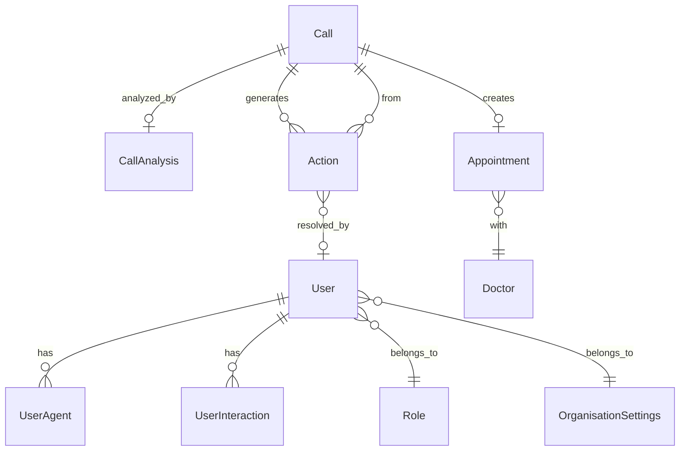

<p align="center">
  
  
  
  
  
  
  
</p>

# 🏥 Clinic AI — Intelligent Voice Agent & Operations Platform

> **An end-to-end AI-powered voice assistant and clinic management platform** that autonomously handles inbound patient calls via Twilio, books appointments conversationally, and surfaces real-time analytics through a modern dashboard — reducing front-desk workload by automating the entire call lifecycle from pickup to post-call analysis.

---

## 📖 Overview

**Clinic AI** is a production-grade, three-tier application that replaces traditional clinic phone systems with an intelligent voice agent. When a patient calls the clinic's Twilio number, the AI receptionist ("Saloni") answers in real-time, understands the caller's intent, navigates a multi-step conversational flow (booking, cancellation, rescheduling, doctor inquiries, urgent triage), and books appointments directly into the database — all without human intervention.

### The Problem

Clinics lose **30–40% of potential appointments** to missed calls, hold times, and after-hours inquiries. Manual call handling is expensive, error-prone, and doesn't scale.

### The Solution

| Capability | Description |
|---|---|
| **Voice Agent** | Real-time AI receptionist powered by LLM (Groq/OpenRouter), Deepgram STT, and Cartesia TTS over Twilio |
| **Automated Booking** | Multi-step conversational flow: date → specialization → time slot → patient details → confirmation → booking |
| **Post-Call AI Analysis** | Every call is automatically transcribed, summarized, categorized, and sentiment-analyzed by Groq LLM |
| **Action Generation** | AI identifies follow-up tasks (callbacks, urgent cases, complaints) and creates trackable action items |
| **Operations Dashboard** | Real-time KPIs, call analytics, sentiment trends, appointment funnels, and heatmaps |

### Target Users

- **Clinic administrators** — monitor call outcomes, appointments, and AI performance
- **Healthcare operations teams** — track action items, manage doctors, generate reports
- **Patients** — book, reschedule, or cancel appointments via natural phone conversation

---

## ✨ Features

### Voice Bot (`clinic-bot`)
- 🎙️ **Real-time speech-to-text** via Deepgram with Voice Activity Detection (Silero VAD)
- 🤖 **LLM-driven conversation** using Groq (Llama 3.3 70B) with automatic API key rotation across 6 keys
- 🔄 **OpenRouter fallback** — seamless failover when Groq rate-limits are exhausted
- 🗣️ **Natural text-to-speech** via Cartesia with optimized voice characteristics
- 📞 **Twilio WebSocket integration** — handles inbound calls via TwiML + media streams
- 🧠 **Pipecat Flows state machine** — structured multi-node conversation flow (initial → booking → confirmation → end)
- 🎯 **Rule-based intent classification** with confidence scoring (booking, cancellation, rescheduling, urgent, FAQ)
- 🔇 **Silence detection** — automatic "Are you still there?" prompts after 8 seconds of inactivity
- 🔊 **Local call recording** — WAV audio capture of both input and output streams
- 📝 **Runtime telemetry** — stage durations, fallback counts, interruption tracking, external call latency

### Backend API (`clinic-backend`)
- 🔐 **JWT authentication** with bcrypt password hashing and role-based access control
- 🛡️ **CSRF protection** via double-submit cookie pattern
- 🤖 **Post-call AI analysis** — Groq LLM extracts summaries, sentiment, categories, and actionable items
- 📊 **Dashboard analytics** — aggregated KPIs, outcome distributions, call volume trends, sentiment breakdowns
- 📋 **Dynamic report generator** — configurable filters, column selection, sorting, date ranges, CSV export
- 👨‍⚕️ **Doctor & schedule management** — CRUD operations with working hours, working days, and slot computation
- 📅 **Smart slot availability** — real-time 30-minute slot generation with conflict detection
- 🏢 **Multi-tenant admin** — organisation settings, user invitations, role management, status control
- ⏱️ **Configurable cron jobs** with feature flag toggle (`DISABLE_CRONS`)
- 🚦 **Rate limiting** via `@nestjs/throttler` with configurable TTL and request limits

### Frontend Dashboard (`clinic-frontend`)
- 📈 **Real-time analytics dashboard** — call volumes, conversion rates, sentiment trends, heatmaps
- 🎧 **Waveform audio player** — listen to call recordings with visual waveform display
- 💬 **Transcript viewer** — searchable, timestamped conversation transcripts
- 📊 **Interactive charts** — Recharts, Chart.js, and D3 visualizations (funnels, donuts, histograms, tornado charts)
- ✅ **Action management** — track, resolve, and comment on AI-generated follow-up tasks
- 🔔 **Push notifications** via Web Push API (VAPID keys)
- 📱 **Responsive design** — mobile-first with Tailwind CSS and shadcn/ui component library
- 🌙 **Dark mode** support via `next-themes`
- 🔀 **Drag-and-drop** interfaces using `@dnd-kit`
- 📄 **PDF generation** for reports via jsPDF

---

## 🛠️ Tech Stack

### Backend

| Layer | Technology |
|---|---|
| **Framework** | NestJS 11 (TypeScript) |
| **Database** | PostgreSQL with TypeORM ORM |
| **Authentication** | Passport.js + JWT (`@nestjs/jwt`, `passport-jwt`) |
| **Validation** | class-validator + class-transformer + Zod |
| **AI/LLM** | Groq SDK (Llama 3.1 8B for analysis) |
| **Security** | Helmet, CSRF Guard, Rate Limiting, Security Middleware |
| **Email** | Nodemailer + Resend |
| **Scheduling** | `@nestjs/schedule` (cron jobs) |
| **HTTP Client** | Axios |

### Frontend

| Layer | Technology |
|---|---|
| **Framework** | Next.js 16 (React 19, TypeScript) |
| **State Management** | Zustand + TanStack React Query + Redux Toolkit |
| **UI Components** | shadcn/ui (Radix UI primitives) + Ant Design + MUI |
| **Styling** | Tailwind CSS 3 + Framer Motion animations |
| **Charts** | Recharts, Chart.js, D3 |
| **Forms** | React Hook Form + Zod/Yup resolvers |
| **Tables** | TanStack React Table + AG Grid |
| **Real-time** | Socket.IO client + WebSocket |
| **Maps** | React Google Maps, React Leaflet |
| **Testing** | Vitest + React Testing Library |
| **Code Quality** | ESLint + Prettier + Husky + Commitlint + lint-staged |

### Voice Bot

| Layer | Technology |
|---|---|
| **Framework** | Pipecat AI (Python) |
| **Telephony** | Twilio (TwiML + Media Streams) |
| **Speech-to-Text** | Deepgram |
| **Text-to-Speech** | Cartesia |
| **LLM** | Groq (Llama 3.3 70B Versatile) + OpenRouter fallback |
| **Conversation Engine** | Pipecat Flows (state machine) |
| **Web Server** | FastAPI + Uvicorn |
| **VAD** | Silero VAD |

### Infrastructure

| Layer | Technology |
|---|---|
| **Containerization** | Docker (multi-stage builds, non-root users, healthchecks) |
| **CI/CD** | GitHub Actions → GCP Artifact Registry → Compute Engine via IAP SSH |
| **Cloud** | Google Cloud Platform (GCE, Artifact Registry, Workload Identity Federation) |
| **Cloud (Alt)** | AWS ECR (alternative deploy script) |
| **Runtime** | Node.js 22 (slim) |

---

## 🏗️ Architecture

```
┌──────────────────────────────────────────────────────────────────┐
│                        PATIENT PHONE CALL                        │
│                     (Twilio Inbound Number)                       │
└───────────────────────────┬──────────────────────────────────────┘
                            │ TwiML + WebSocket Media Stream
                            ▼
┌──────────────────────────────────────────────────────────────────┐
│                     VOICE BOT (Python/Pipecat)                    │
│  ┌─────────┐  ┌───────────┐  ┌──────────┐  ┌────────────────┐   │
│  │Deepgram │→│ Groq LLM  │→│ Cartesia │→│ Twilio Stream  │   │
│  │  STT    │  │(Llama 3.3)│  │   TTS    │  │  (WebSocket)   │   │
│  └─────────┘  └─────┬─────┘  └──────────┘  └────────────────┘   │
│                      │ Tool Calls (book, lookup, context)         │
│  ┌───────────────────┴──────────────────────────────────────┐    │
│  │              Pipecat Flows State Machine                  │    │
│  │  initial → booking → date → spec → time → confirm → end  │    │
│  └───────────────────────────────────────────────────────────┘    │
└───────────────────────────┬──────────────────────────────────────┘
                            │ REST API (HTTP)
                            ▼
┌──────────────────────────────────────────────────────────────────┐
│                   BACKEND API (NestJS/TypeScript)                  │
│  ┌──────────┐ ┌──────────────┐ ┌───────────┐ ┌──────────────┐   │
│  │   Auth   │ │ Appointments │ │   Calls   │ │  Dashboard   │   │
│  │ (JWT)    │ │  (Booking,   │ │ (Ingest,  │ │ (KPIs, Charts│   │
│  │          │ │  Slots, Drs) │ │  Query)   │ │  Insights)   │   │
│  └──────────┘ └──────────────┘ └─────┬─────┘ └──────────────┘   │
│  ┌──────────┐ ┌──────────────┐       │       ┌──────────────┐   │
│  │  Admin   │ │   Reports    │       │       │   Actions    │   │
│  │(Org, Usr)│ │(Dynamic Gen) │       ▼       │(AI-Generated)│   │
│  └──────────┘ └──────────────┘  ┌────────┐   └──────────────┘   │
│                                  │AI Svc  │                      │
│                                  │(Groq)  │                      │
│                                  └────┬───┘                      │
└───────────────────────────────────────┼──────────────────────────┘
                                        │
                            ┌───────────▼───────────┐
                            │     PostgreSQL DB      │
                            │  21 entities, TypeORM  │
                            └───────────────────────┘
                                        ▲
┌───────────────────────────────────────┼──────────────────────────┐
│                 FRONTEND (Next.js 16 / React 19)                  │
│  ┌──────────┐ ┌───────────┐ ┌────────┐ ┌────────┐ ┌──────────┐  │
│  │Dashboard │ │Call Detail│ │Actions │ │Reports │ │  Admin   │  │
│  │(Charts,  │ │(Transcript│ │(Task   │ │(Dynamic│ │(Settings,│  │
│  │ KPIs)    │ │ Audio)    │ │ Mgmt)  │ │ Build) │ │ Users)   │  │
│  └──────────┘ └───────────┘ └────────┘ └────────┘ └──────────┘  │
└──────────────────────────────────────────────────────────────────┘
```

### Key Architecture Patterns

- **Event-Driven Call Processing** — Bot ingests call data via `POST /api/calls/ingest`; backend fires-and-forgets AI analysis asynchronously
- **State Machine Conversation** — Pipecat Flows enforce a strict node graph preventing hallucinated actions or out-of-order booking steps
- **API Key Rotation with Fallback** — `RotatedGroqLLMService` cycles through 6 Groq keys and falls back to OpenRouter on exhaustion
- **TTL-Based Context Cache** — `ClinicBackendClient` caches doctor/slot data for 45 seconds to minimize backend calls during a conversation
- **Double-Submit Cookie CSRF** — More secure than deprecated `csurf`, with JWT bearer bypass for API clients

---

## 📁 Project Structure

```
clinic-ai/
├── clinic-backend/                  # NestJS REST API
│   ├── src/
│   │   ├── entities/                # 21 TypeORM entities (User, Call, Appointment, Doctor, Action, etc.)
│   │   ├── user/                    # Auth module (JWT login/register, profile, guards, strategies)
│   │   ├── appointments/            # Booking, slot computation, doctor CRUD, clinic context
│   │   ├── call/                    # Call ingestion, querying, CSV export
│   │   ├── ai/                      # Groq-powered post-call analysis (summary, sentiment, actions)
│   │   ├── dashboard/               # Aggregated KPIs, analytics insights, reservation stats
│   │   ├── actions/                 # AI-generated follow-up task management
│   │   ├── reports/                 # Dynamic report builder with filters and export
│   │   ├── admin/                   # Organisation settings, user management, role control
│   │   ├── common/                  # Guards, middleware, interceptors, pipes, filters, utils
│   │   │   ├── guards/              # Rate limit, CSRF, bot API key guards
│   │   │   ├── middleware/          # Security headers, suspicious request detection
│   │   │   ├── interceptors/        # Transform, CSRF token, JWT validation
│   │   │   └── filters/             # Global HTTP exception filter
│   │   └── main.ts                  # Bootstrap with Helmet, CORS, validation, cookie parser
│   ├── Dockerfile                   # Multi-stage production build (node:22-slim, non-root)
│   └── package.json
│
├── clinic-bot/                      # Python Voice Agent
│   ├── bot.py                       # Core bot logic: Pipecat pipeline, flow nodes, tool handlers (1,350+ lines)
│   ├── runtime.py                   # Backend client with caching, intent classifier, telemetry, call summarizer
│   ├── tools.py                     # Tool function wrappers (book, lookup, cancel, reschedule, ingest)
│   ├── server.py                    # FastAPI server with Twilio TwiML + WebSocket endpoints
│   └── requirements.txt
│
├── clinic-frontend/                 # Next.js Dashboard
│   ├── src/
│   │   ├── app/                     # App Router pages (dashboard, calls, actions, reports, admin, login, etc.)
│   │   ├── components/              # 55+ components (charts, tables, audio player, transcript viewer, etc.)
│   │   ├── hooks/                   # Custom hooks (use-dashboard, use-calls, use-actions, use-push-notifications)
│   │   ├── store/                   # Zustand auth store
│   │   ├── api/                     # API client layers (chatbot, whatsapp)
│   │   ├── lib/                     # Shared utilities and API helpers
│   │   └── types/                   # TypeScript type definitions
│   ├── .github/workflows/deploy.yml # GitHub Actions CI/CD → GCP
│   ├── Dockerfile                   # Multi-stage standalone build (builder + runner)
│   ├── deploy.sh                    # AWS ECR deployment script (alternative)
│   └── package.json
│
└── Clinicall Demo Video.mp4         # Project demo recording
```

---

## 🎬 Demo

A full demonstration video of the platform is included in the repository:

📹 **[Clinicall Demo Video.mp4](./Clinicall%20Demo%20Video.mp4)** — End-to-end walkthrough showcasing the voice agent handling a live call, booking an appointment, and the dashboard reflecting real-time analytics.

---

## 🚀 Getting Started

### Prerequisites

| Requirement | Version |
|---|---|
| **Node.js** | ≥ 22.x |
| **Python** | ≥ 3.11 |
| **PostgreSQL** | ≥ 15 |
| **npm** | ≥ 10.x |
| **Docker** (optional) | ≥ 24.x |
| **Twilio Account** | With phone number and TwiML app configured |
| **Groq API Key(s)** | At least one, recommended: 6 for rotation |
| **Deepgram API Key** | For speech-to-text |
| **Cartesia API Key** | For text-to-speech |
| **Daily API Key** | For Pipecat transport |

### Installation

```bash
# Clone the repository
git clone https://github.com/Tanmay-Awal/clinic-ai.git
cd clinic-ai
```

#### 1. Backend Setup

```bash
cd clinic-backend
npm install

# Create and configure .env (see Environment Variables below)
cp .env.example .env

# Create the database
createdb clinic_db

# Run database migrations
npm run migration:run

# Start in development mode
npm run start:dev
```

#### 2. Voice Bot Setup

```bash
cd clinic-bot

# Create virtual environment
python -m venv venv
source venv/bin/activate   # Linux/Mac
# venv\Scripts\activate    # Windows

pip install -r requirements.txt

# Configure .env (see Environment Variables below)
cp .env.example .env

# Start the bot server
python server.py
```

#### 3. Frontend Setup

```bash
cd clinic-frontend
npm install

# Configure .env (see Environment Variables below)
cp .env.example .env

# Start in development mode
npm run dev
```

### Environment Variables

#### Backend (`clinic-backend/.env`)

| Variable | Description | Required |
|---|---|---|
| `PORT` | Server port | Yes (default: `3001`) |
| `NODE_ENV` | Environment (`development` / `production`) | Yes |
| `DB_HOST` | PostgreSQL host | Yes |
| `DB_PORT` | PostgreSQL port | Yes (default: `5432`) |
| `DB_USERNAME` | Database username | Yes |
| `DB_PASSWORD` | Database password | Yes |
| `DB_DATABASE` | Database name | Yes (default: `clinic_db`) |
| `JWT_SECRET` | JWT signing secret | Yes |
| `JWT_EXPIRES_IN` | JWT token expiry | Yes (default: `7d`) |
| `COOKIE_SECRET` | Cookie signing secret | Yes |
| `CORS_ORIGINS` | Allowed CORS origins (comma-separated) | Yes |
| `RATE_LIMIT_DURATION` | Rate limit window (ms) | No (default: `60000`) |
| `RATE_LIMIT_MAX_REQUESTS` | Max requests per window | No (default: `100`) |
| `GROQ_API_KEY` | Groq API key for post-call analysis | Yes |
| `BOT_API_KEY` | Shared secret for bot → backend auth | Yes |
| `DISABLE_CRONS` | Feature flag for cron jobs | No (default: `false`) |
| `DB_POOL_MAX` | Connection pool max size | No (default: `2`) |
| `DB_IDLE_TIMEOUT` | Idle connection timeout (ms) | No (default: `30000`) |

#### Voice Bot (`clinic-bot/.env`)

| Variable | Description | Required |
|---|---|---|
| `DAILY_API_KEY` | Daily.co API key (Pipecat transport) | Yes |
| `OPENAI_API_KEY` | OpenAI API key (optional fallback) | No |
| `GROQ_API_KEY` through `GROQ_API_KEY_6` | Groq API keys for rotation | Yes (at least 1) |
| `DEEPGRAM_API_KEY` | Deepgram STT API key | Yes |
| `CARTESIA_API_KEY` | Cartesia TTS API key | Yes |
| `BACKEND_URL` | Backend API base URL | Yes |
| `TWILIO_ACCOUNT_SID` | Twilio account SID | Yes |
| `TWILIO_AUTH_TOKEN` | Twilio auth token | Yes |
| `BOT_API_KEY` | Shared secret for bot → backend auth | Yes |
| `OPENROUTER_API_KEY` | OpenRouter API key (LLM fallback) | No |
| `BOT_CONTEXT_CACHE_TTL` | Context cache TTL in seconds | No (default: `45`) |

#### Frontend (`clinic-frontend/.env`)

| Variable | Description | Required |
|---|---|---|
| `NEXT_PUBLIC_API_URL` | Backend API base URL | Yes |
| `NEXT_PUBLIC_VAPID_PUBLIC_KEY` | Web Push VAPID public key | No |

### Running Locally

```bash
# Terminal 1 — Backend
cd clinic-backend && npm run start:dev

# Terminal 2 — Bot
cd clinic-bot && source venv/bin/activate && python server.py

# Terminal 3 — Frontend
cd clinic-frontend && npm run dev
```

| Service | URL |
|---|---|
| Backend API | `http://localhost:3001/api` |
| Voice Bot | `http://localhost:8765` |
| Frontend | `http://localhost:3000` |

### Running with Docker

```bash
# Backend
cd clinic-backend
docker build --target production -t clinic-backend .
docker run -p 3001:3000 --env-file .env clinic-backend

# Frontend
cd clinic-frontend
docker build -t clinic-frontend .
docker run -p 3000:3000 --env-file .env clinic-frontend
```

---

## 📡 API Documentation

**Base URL:** `http://localhost:3001/api`

### Authentication

All protected endpoints require a JWT Bearer token:

```
Authorization: Bearer <access_token>
```

Bot-to-backend endpoints use a shared API key:

```
x-bot-api-key: <BOT_API_KEY>
```

### Core Endpoints

#### Authentication

| Method | Endpoint | Auth | Description |
|---|---|---|---|
| `POST` | `/user/register` | None | Register a new user |
| `POST` | `/user/login` | None | Login and receive JWT |
| `GET` | `/user/profile` | JWT | Get current user profile |
| `PUT` | `/user/profile` | JWT | Update profile |

#### Calls

| Method | Endpoint | Auth | Description |
|---|---|---|---|
| `POST` | `/calls/ingest` | Bot API Key | Ingest call data from voice bot |
| `POST` | `/calls` | JWT | Query calls (paginated, filtered) |
| `GET` | `/calls/:id` | JWT | Get call detail with transcript & analysis |
| `GET` | `/calls/csv` | JWT | Export calls as CSV |

#### Appointments

| Method | Endpoint | Auth | Description |
|---|---|---|---|
| `GET` | `/appointments` | — | List all appointments |
| `POST` | `/appointments` | — | Create appointment (used by bot) |
| `PUT` | `/appointments/:id` | — | Update/cancel/reschedule appointment |
| `GET` | `/appointments/doctors` | — | List all doctors |
| `GET` | `/appointments/slots?doctorId=&date=` | — | Get available slots |
| `GET` | `/appointments/context?date=&daysAhead=` | — | Full clinic context snapshot |
| `GET` | `/appointments/lookup/:phone` | — | Lookup appointments by phone |

#### Dashboard

| Method | Endpoint | Auth | Description |
|---|---|---|---|
| `GET` | `/dashboard/stats` | — | Summary KPIs (calls, conversions, sentiment) |
| `POST` | `/dashboard/reservation` | — | Reservation analytics with date filters |
| `POST` | `/dashboard/analytics-insights` | — | AI-powered analytics insights |
| `GET` | `/dashboard/activity` | — | Recent activity feed |

#### Actions

| Method | Endpoint | Auth | Description |
|---|---|---|---|
| `GET` | `/actions` | JWT | List actions (filtered, paginated) |
| `GET` | `/actions/:id` | JWT | Get action detail |
| `PUT` | `/actions/:id` | JWT | Update/resolve action |
| `POST` | `/actions/stats` | JWT | Action statistics |

#### Reports

| Method | Endpoint | Auth | Description |
|---|---|---|---|
| `GET` | `/reports/:type/metadata` | JWT | Report schema (columns, types) |
| `GET` | `/reports/:type/suggestions` | JWT | Column value autocomplete |
| `POST` | `/reports/:type/generate` | JWT | Generate report with filters |

#### Admin

| Method | Endpoint | Auth | Description |
|---|---|---|---|
| `GET` | `/admin/settings` | JWT | Get organisation settings |
| `PUT` | `/admin/settings` | JWT | Update organisation settings |
| `GET` | `/admin/users` | JWT | List organisation users |
| `POST` | `/admin/users/invite` | JWT | Invite new user |
| `PATCH` | `/admin/users/:id/status` | JWT | Enable/disable user |
| `PATCH` | `/admin/users/:id/role` | JWT | Change user role |
| `DELETE` | `/admin/users/:id` | JWT | Remove user |

### Example: Call Ingestion

```bash
curl -X POST http://localhost:3001/api/calls/ingest \
  -H "Content-Type: application/json" \
  -H "x-bot-api-key: clinic_bot_secret_key_2026" \
  -d '{
    "call_id": "pipecat_abc123",
    "caller_phone": "+447700900001",
    "start_time": "2026-07-25T10:00:00Z",
    "end_time": "2026-07-25T10:05:30Z",
    "transcript": [{"role": "assistant", "transcript": "Hello, City Health Clinic..."}],
    "call_summary": "Patient booked appointment with Dr. Smith for Monday.",
    "intent": "booking",
    "booking_result": {"appointment_id": 42}
  }'
```

---

## 🗄️ Database

### Technology

**PostgreSQL** with **TypeORM** (21 entities, `synchronize: false` for production safety, UTC timezone enforcement).

### Core Entities & Relationships



### Main Entities

| Entity | Purpose |
|---|---|
| `User` | Staff accounts with roles, org membership, plan tracking |
| `Call` | Full call record (duration, transcript, recording, category, source) |
| `CallAnalysis` | AI-generated summary, sentiment, success flag |
| `Appointment` | Patient bookings linked to doctors and source calls |
| `Doctor` | Practitioners with specializations, working hours, and schedules |
| `Action` | AI-generated follow-up tasks (callbacks, complaints, urgent cases) |
| `OrganisationSettings` | Multi-tenant clinic configuration |
| `WeeklyInsight` / `MonthlyInsight` | Aggregated analytics snapshots |
| `FeedbackDetails` | Structured feedback from calls |
| `GeneralIssue` | Tracked general issues from calls |
| `Location` / `UserLocation` | Multi-site location management |

---

## 🧪 Testing

### Backend

```bash
cd clinic-backend

# Unit tests
npm test

# Watch mode
npm run test:watch

# Coverage report
npm run test:cov

# E2E tests
npm run test:e2e

# Debug mode
npm run test:debug
```

**Framework:** Jest 30 + ts-jest + Supertest

### Frontend

```bash
cd clinic-frontend

# Run tests
npx vitest

# Lint
npm run lint
```

**Framework:** Vitest + React Testing Library + @testing-library/user-event

---

## 🚢 Deployment

### CI/CD Pipeline (GitHub Actions → GCP)

The frontend ships with a production CI/CD pipeline:

1. **Trigger:** Push to `main` branch or manual dispatch
2. **Auth:** Google Workload Identity Federation (no service account keys)
3. **Build:** Docker multi-stage build → push to GCP Artifact Registry
4. **Deploy:** IAP SSH into Compute Engine VM → pull & restart container
5. **Health Check:** Automated post-deploy curl to `/health`

### Docker Production Builds

Both backend and frontend Dockerfiles implement security best practices:

- **Multi-stage builds** — separate builder and runtime stages
- **Non-root users** — `nestjs:nodejs` (backend) and `nextjs:nodejs` (frontend)
- **Health checks** — `curl` to `/api/health` and `/health` endpoints
- **Slim base images** — `node:22-slim` for minimal attack surface
- **Production dependencies only** — `npm prune --production`
- **Next.js standalone output** — minimal deployment footprint

### Alternative AWS Deployment

```bash
cd clinic-frontend
./deploy.sh <AWS_PROFILE> <ACCOUNT_ID> <REGION> <SSH_USER> <prod|dev>
```

Builds Docker image → pushes to AWS ECR → SSH deploys to EC2 instance.

---

## 🔒 Security

### Authentication & Authorization

| Mechanism | Implementation |
|---|---|
| **Password Hashing** | bcrypt with 10 salt rounds |
| **JWT Tokens** | Signed with configurable secret, 7-day expiry |
| **Role-Based Access** | Admin, User roles with guard-level enforcement |
| **Bot API Key** | Shared secret for machine-to-machine auth (`x-bot-api-key` header) |
| **Production Guard** | Registration disabled in production via `ProductionGuard` |

### Request Security

| Mechanism | Implementation |
|---|---|
| **CSRF Protection** | Double-submit cookie pattern with format validation |
| **Helmet** | Security headers (CSP, HSTS, X-Frame-Options, etc.) |
| **Rate Limiting** | Configurable per-minute request throttling (`@nestjs/throttler`) |
| **Input Validation** | Global `ValidationPipe` with whitelist, transform, and implicit conversion |
| **Request Size Limit** | 10MB maximum request body |
| **Suspicious UA Detection** | Logs requests from known attack tools (sqlmap, nikto, Burp, etc.) |

### Frontend Security

| Mechanism | Implementation |
|---|---|
| **Content Security Policy** | Strict CSP headers in `next.config.ts` |
| **HSTS** | 2-year max-age with preload |
| **X-Frame-Options** | `DENY` (no iframe embedding) |
| **Permissions Policy** | Camera, microphone, geolocation disabled |
| **Environment Isolation** | Separate CSP rules for development vs. production |

### Secrets Management

- API keys stored in `.env` files (gitignored)
- GCP Workload Identity Federation (no static service account keys in CI/CD)
- Bot API key validated via dedicated `BotApiKeyGuard`

---

## ⚡ Performance Considerations

| Strategy | Details |
|---|---|
| **Context Caching** | Bot caches clinic context (doctors, slots) with 45s TTL to avoid redundant API calls during a single conversation |
| **System Message Consolidation** | `RotatedGroqLLMService` consolidates system prompts for LLM prefix stability and potential prompt caching |
| **Connection Pooling** | PostgreSQL pool configured with min/max, idle timeout, and connection timeout |
| **API Key Rotation** | 6 Groq keys rotated on rate-limit hits, with OpenRouter failover — ensuring ~zero downtime |
| **Fire-and-Forget Analysis** | Post-call AI analysis runs asynchronously (non-blocking call ingestion) |
| **Standalone Next.js** | `output: 'standalone'` for minimal production bundle size |
| **Virtualized Lists** | `react-window` and `react-virtualized` for large data rendering |
| **Memory Management** | Frontend dev server runs with `--max-old-space-size=4096` |
| **Efficient Slot Computation** | Server-side 30-minute slot generation with in-query conflict detection |
| **Pagination** | All list endpoints support cursor-based pagination with total counts |

---

## 🧩 Challenges & Engineering Decisions

| Decision | Rationale |
|---|---|
| **Pipecat Flows over free-form LLM** | Enforcing a strict state machine prevents hallucinated bookings and ensures every required field is collected before confirming |
| **Multi-key Groq rotation** | Free-tier Groq has aggressive rate limits; rotating across 6 keys provides a ≈6x throughput multiplier with automatic failover |
| **OpenRouter fallback** | If all Groq keys are exhausted, the bot seamlessly switches to OpenRouter (same Llama 3.3 model) and switches back after the request |
| **Double-submit CSRF over csurf** | The `csurf` package is deprecated; double-submit cookie pattern is more secure and doesn't require server-side session storage |
| **Separate bot microservice** | Python ecosystem has superior AI/ML tooling (Pipecat, Deepgram SDKs); TypeScript handles the CRUD/analytics workload |
| **Post-call AI analysis** | Rather than real-time analysis (which adds latency), analysis is async — the bot sends raw data, and NestJS triggers Groq analysis as fire-and-forget |
| **TypeORM synchronize: false** | Production databases use migration-based schema management to prevent accidental data loss |
| **Consolidated system messages** | Merging multiple system prompts into one reduces token count and improves LLM response consistency |

---

## 🔮 Future Improvements

- [ ] **Outbound call campaigns** — proactive appointment reminders and follow-ups via the voice bot
- [ ] **WhatsApp integration** — extend the bot to handle booking via WhatsApp (API layer already scaffolded)
- [ ] **Multi-language support** — i18next infrastructure is already in place in the frontend
- [ ] **Real-time WebSocket dashboard** — Socket.IO client is installed; connect to backend events for live call updates
- [ ] **Stripe billing** — Stripe React SDK is already integrated; build subscription and payment flows
- [ ] **Google OAuth SSO** — Frontend has Google client ID configured; implement OAuth login flow
- [ ] **Call recording playback** — Waveform player component exists; integrate with backend recording storage
- [ ] **A/B testing of bot prompts** — swap flow node prompts dynamically via admin settings
- [ ] **OpenTelemetry observability** — structured tracing across bot → backend → database
- [ ] **Automated E2E test suite** — Playwright/Cypress tests for critical dashboard flows

---

## 🤝 Contributing

1. **Fork** the repository
2. **Create** a feature branch (`git checkout -b feature/your-feature`)
3. **Commit** with conventional commits (`git commit -m "feat: add new feature"`)
4. **Push** to your branch (`git push origin feature/your-feature`)
5. **Open** a Pull Request

### Code Quality

- ESLint + Prettier enforced via Husky pre-commit hooks
- Commitlint enforces conventional commit messages
- lint-staged runs formatters only on staged files

---

## 📄 License

This project is **proprietary/unlicensed** (`UNLICENSED` in `package.json`). All rights reserved.

---

## 👤 Author

**Tanmay Awal**

- GitHub: [@Tanmay-Awal](https://github.com/Tanmay-Awal)
- Repository: [clinic-ai](https://github.com/Tanmay-Awal/clinic-ai)

---

<p align="center">
  <sub>Built with ❤️ using NestJS, Next.js, Pipecat AI, and PostgreSQL</sub>
</p>
